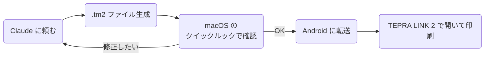

# はじめに

テプラ，便利ですよね。私は部屋の物品の整理整頓に活用しています。収納ボックスのラベリングにとても便利です。

最近のテプラはスマートフォンから Bluetooth で印刷できるモデルも多く，専用アプリの **TEPRA LINK 2** でラベルを作って印刷します。キーボード付きの本体でぽちぽち打っていた時代を考えると，かなり進化しました。

https://www.kingjim.co.jp/sp/tepralink2/

…なのですが，**このアプリ，正直使いにくくないですか？**

- 1 枚作るぶんには困らない。でも **ちょっと凝ったデザインにしようとすると途端につらい**。文字の位置・サイズ・枠線・反転を，スマートフォンの小さな画面で指先で調整することになる
- オリジナルの画像素材を入れたいとき，素材をスマートフォンに送って，アプリに取り込んで，位置とサイズを合わせて…という作業が地味に重い
- 一度作ったラベルを「同じデザインで文言だけ変えたい」と思っても，それなりに手数がかかる

一つひとつは小さなだるさなのですが，積み重なると「まあ手書きでいいか…」となってしまいがちです。せっかく便利な道具なのに，アプリの操作がボトルネックになっているのはもったいない。

ところで，昨今は Claude Code をはじめとする AI エージェントに，コードを書かせるのも，ドキュメントを書かせるのも当たり前になりました。だったら，

> 「サーバーラックのケーブル用に， `web-01` 〜 `web-08` と `db-01` `db-02` のラベルを両端用に 2 枚ずつ，角丸枠で作っといて」

って **Claude に全任せできたらステキじゃないですか？**

というわけで，作りました。

https://github.com/mpyw/tepra.tm2

# tepra.tm2 とは

**tepra.tm2** は， TEPRA LINK 2 が保存するラベルファイル（ `.tm2` ）を生成・読み取り・編集するツールです。 Go で書かれていて，以下の 3 通りで使えます。

| 使い方 | 内容 |
|:---|:---|
| **MCP サーバー** | `tm2 mcp` で起動。 Claude などの AI アシスタントに自然言語で頼むと `.tm2` ファイルを作ってくれる |
| CLI | `tm2 text` `tm2 pages` `tm2 pour` などのコマンドで `.tm2` ファイルを作る |
| Go ライブラリ | `github.com/mpyw/tepra.tm2` を import して，プログラムから `.tm2` ファイルを作る |

CLI やライブラリとしても使えますが， **この記事では MCP サーバーとして Claude に使ってもらう前提** で紹介します。オプションの名前やファイルの構造を覚えなくても「こういうラベルが欲しい」と言葉で伝えるだけで済むのが一番の魅力だからです。

tepra.tm2 はあくまで **ファイルを作るだけ** で，印刷は今まで通り TEPRA LINK 2 から行います。プリンタと直接通信するわけではないので，プリンタの機種に依存しにくく，アプリ上で最終確認してから印刷できるという安心感もあります。

:::message alert
**tepra.tm2 は非公式ツールです。** キングジムは `.tm2` 形式の仕様を公開していません。アプリが書き出したファイルを解析し，各設定がアプリの画面上でどう表示されるかを確認しながら作っています。アプリのアップデートで形式が変わる可能性がある点はご了承ください。

また `.tm2` は TEPRA LINK 2 専用の形式です。 Windows 向けの **テプラクリエイターでは開けません。**
:::

## できること

MCP サーバーとしては，以下のツールを提供しています。

| ツール | 内容 |
|:---|:---|
| `create_text_label` | 1 枚のラベルを作る |
| `create_label_pages` | 1 つのファイルに複数ページのラベルを作る。ページごとに文字サイズと長さを自動調整し，長さを揃えることもできる。テキストのラベルを何枚も作るなら基本こちら |
| `create_pour_labels` | 流し込みラベルを作る。 QR コード・バーコードはこちら。アプリの表でデータを編集できる |
| `inspect_label` | `.tm2` ファイルの中身を読む。アプリで保存したファイルも読める |
| `edit_label` | `.tm2` ファイルを JSON Patch で書き換える |

ラベルの見た目に関わる設定は一通り揃えています。

- テープ幅： 4 / 6 / 9 / 12 / 18 / 24 / 36 / 50 mm
- 文字：サイズ（省略時はテープ幅いっぱい），太字，左右・上下の揃え，回転，縦書き
- 装飾：反転（白抜き文字），網掛け，枠線（四角・角丸・上下・上のみ・下のみ）と線の太さ
- 画像：文字の前に置くアイコン，ラベル全体に敷く背景画像（PNG / JPEG / GIF を 2 値化）
- コード： QR コード， CODE39 ， CODE128 ， JAN-13
- 長さ：内容に合わせて自動，または長さを固定

特に嬉しいのが **アイコンと背景画像** です。手元の PNG のパスを渡すだけで，アプリでの取り込み・位置合わせの手間なしに画像入りのラベルが作れます。

# 作品例

まずは何ができるのかを見てもらうのが早いと思うので，実際に Claude に作ってもらったラベルを並べます。

## 凝った装飾のラベル

反転・網掛け・枠線の組み合わせに加えて，飾り枠の PNG を背景に敷いたものも作れます。


## Gopher くんのいろんなポーズを使ったラベル

ポーズ違いの Gopher くんを，テープで印刷しやすい白黒の線画にしてアイコンとして入れています。

:::message
Gopher くんの画像は Egon Elbre さんの [egonelbre/gophers](https://github.com/egonelbre/gophers)（[CC0](https://creativecommons.org/publicdomain/zero/1.0/)）を使っています。 Go Gopher のオリジナルデザインは [Renée French](https://reneefrench.blogspot.com/) さんによるもので， [CC BY 4.0](https://creativecommons.org/licenses/by/4.0/) で提供されています。
:::


## 大量のラベルを一括で

`web-01` 〜 `web-08` と `db-01` `db-02` を 2 枚ずつ，計 20 枚のケーブル用ラベルを 1 ファイルにまとめたものです。


URL を QR コードにした流し込みラベルです。アプリの表でデータを確認・編集できます。


調味料ボトル用に 12 種類まとめて作ったうちの 1 枚です。


# インストール

使っているアプリに合わせて，どちらかの方法で入れてください。

| 方法 | 向いている人 | 必要なもの |
|:---|:---|:---|
| Claude Desktop に拡張機能として入れる | 非エンジニア。ターミナルを使ったことがない人 | macOS か Windows の Claude Desktop |
| tm2 コマンドを入れて MCP サーバーとして登録する | エンジニア。 Claude Code や他の MCP クライアントで使いたい人 | ターミナル |

## 非エンジニア向け： Claude Desktop

Claude Desktop 向けに，ダウンロードして開くだけで入る拡張機能（ `.mcpb` ファイル）を用意しています。ターミナルでの操作や，他のソフトのインストールは要りません。

1. [`tm2.mcpb`](https://github.com/mpyw/tepra.tm2/releases/latest/download/tm2.mcpb) をダウンロードする
2. ダウンロードした `tm2.mcpb` を開く（ダブルクリック）
3. Claude Desktop にインストールの確認が出るので，インストールする

これで準備は完了です。 Claude Desktop のチャットで「テプラのラベルを作って」と頼めば使えます。

:::message
拡張機能が使えるのは **Claude Desktop のチャット** だけです。 Claude Desktop の Code タブは中で Claude Code が動いていて，そのセッションには追加されません。 Code タブで使いたい場合は，次のエンジニア向けの方法で入れてください。
:::

## エンジニア向け： Claude Code や他の MCP クライアント

### tm2 コマンドのインストール

[mise](https://mise.jdx.dev/) を使う方法がおすすめです。

```bash
mise use -g github:mpyw/tepra.tm2
```

mise を使わない場合は， [Releases](https://github.com/mpyw/tepra.tm2/releases) から OS と CPU に合ったアーカイブをダウンロードして， `tm2` を `PATH` の通った場所に置いてください。 macOS ・ Linux ・ Windows の amd64 / arm64 向けのバイナリを用意しています。

Go の環境がある場合は `go install` でも入ります。

```bash
go install github.com/mpyw/tepra.tm2/cmd/tm2@latest
```

### MCP サーバーの登録

Claude Code の場合は，以下のコマンドで登録できます。

```bash
claude mcp add tm2 -- tm2 mcp
```

他の MCP クライアントでも，引数 `mcp` の stdio サーバーとして登録すれば使えます。クライアントによってはシェルの `PATH` を引き継がないので，コマンドは `tm2` の絶対パスで書いておくと確実です（ `which tm2` で確認できます）。

```json
{
    "mcpServers": {
        "tm2": {
            "command": "/absolute/path/to/tm2",
            "args": ["mcp"]
        }
    }
}
```

これで準備は完了です。

# 実際の印刷までの運用

ここからは，筆者が実際にどうやってラベルを作って印刷しているかを紹介します。全体の流れは以下の通りです。



## 1. Claude に頼む

あとは普通に話しかけるだけです。

> 「 `~/Downloads/tepra-labels` に，サーバーラックのケーブル用ラベルを作って。 `web-01` から `web-08` と `db-01` `db-02` を両端用に 2 枚ずつ，テープは 12 mm ，太字で角丸枠，中央揃え。長さは全部揃えて」

Claude が適切なツールとオプションを選んで `.tm2` ファイルを書き出してくれます。この例ならページ（ `create_label_pages` ）に長さを指定して，20 枚が同じ長さで並ぶ 1 つのファイルにしてくれます。 QR コードやバーコードが欲しいときは流し込み（ `create_pour_labels` ）を使う，といった使い分けも任せられます。

画像を使いたい場合も，素材探しから任せてしまえます。

> 「Gopher くんのいろんなポーズの画像を CC0 の素材から探して，テプラで印刷しやすい白黒にして，左にアイコン，右に文字のラベルを作って」

作品例の Gopher くんのラベルは，実際にこの流れで作ってもらいました。 Claude がやってくれた下ごしらえは以下の通りです。

1. **素材を取ってくる**： CC0 で公開されている [egonelbre/gophers](https://github.com/egonelbre/gophers) を clone し，全身が収まっているポーズを選ぶ
2. **SVG を PNG にする**： ImageMagick の SVG 描画では背景が付いたり一部が欠けたりしたので， macOS のクイックルック（ `qlmanage -t` ）で描画し直す
3. **余白を切り落とす**：アイコンとして並べたときに小さくならないよう，周りの白い余白をトリミングする
4. **白黒にして線を太らせる**：そのまま 2 値化すると，水色の体が白に飛んで細い輪郭線だけが残り，テープの解像度では線が消えてしまう。先に縮小してから 2 値化し，線を太らせる

:::details 4. の ImageMagick コマンド

```bash
magick gopher.png \
    -colorspace gray \
    -resize x240 \
    -threshold 55% \
    -morphology Erode Disk:1 \
    -type bilevel \
    gopher-print.png
```

`-morphology Erode` は白い領域を削る処理なので，白地に黒い線の画像では結果的に黒い線が太くなります。

:::

tepra.tm2 自体にも画像を 2 値化する機能（ `image_mode` ・ `image_threshold` ）はあります。ただ「線が細すぎて消える」といった素材側の問題は，こうした下ごしらえをしないと解決できません。ここまで含めて言葉で頼めるのが， AI に任せる一番の強みだと思います。ちなみに `Gopher's Library` やチケット風のラベルで背景に敷いた飾り枠も， Claude に ImageMagick で描いてもらったオリジナル素材です。

一度作ったラベルを直したくなったら，そのまま会話を続けるだけです。

> 「 `Gopher's Library` の文字が飾りにかぶってるから，左右に余白を入れて」

Claude は `inspect_label` でファイルの中身を読んでから `edit_label` で書き換えてくれます。 **アプリで手作りして保存したファイルも読み書きできる** ので，「アプリでデザインを 1 枚作って，文言違いを 30 枚 Claude に量産させる」といった使い方もできます。

## 2. macOS のクイックルックでプレビューする

TEPRA LINK 2 は iOS / Android に加えて，一応 macOS 版も提供されています。

:::message alert
**macOS 版 TEPRA LINK 2 は，筆者の手持ちの SR-MK1 に対応していません。** [公式の対応表](https://www.kingjim.co.jp/sp/tepra_link2/manual/02_00.html) でも SR-MK1 はスマートフォンからの Bluetooth 接続のみで， Mac からは Bluetooth でも USB でも接続できません。そのため macOS 版は印刷には使わず，プレビュー専用として使っています。
:::

印刷はできなくても， macOS 版を入れておく価値は十分にあります。 **TEPRA LINK 2 をインストールすると， Finder のクイックルックで `.tm2` ファイルの中身をプレビューできるようになる** のです。

Claude が書き出したファイルを Finder で選択してスペースキーを押せば，その場でラベルの見た目を確認できます。スマートフォンに転送する前に「文字が小さすぎる」「画像が潰れている」といった問題に気付けるので，修正のループが非常に速く回ります。

Finder をアイコン表示にしておけば，フォルダを開くだけでサムネイルが一覧できます。何十枚もまとめて作ったときの見比べにも便利です。


## 3. Android に転送して TEPRA LINK 2 で印刷する

プレビューで問題なければ，ファイルをスマートフォンに転送します。筆者は Android を使っていて，以下の手順で印刷しています。

1. `.tm2` ファイルを Android 端末に転送する（ USB 接続，クラウドストレージ， Quick Share など何でも OK ）
2. ファイルエクスプローラアプリで転送したファイルを開く
3. 開くアプリとして TEPRA LINK 2 を選ぶ
4. アプリ上でラベルを確認して，印刷する

iOS の場合も，ファイルアプリや共有メニューから TEPRA LINK 2 で開けば同じように印刷できるはずです。

:::message
ファイル名（ `.tm2` を除いた部分）がアプリ上でのラベル名になります。たくさん作ってアプリに取り込んでいく場合は，ファイル名を分かりやすくしておくと後で探しやすくなります。 Claude に「ファイル名は `cable-web.tm2` で」のように指定しておきましょう。
:::

# まとめ

- **テプラは便利。でも TEPRA LINK 2 で凝ったデザインを作ったり大量に作ったりするのはだるい**
- **tepra.tm2 を MCP サーバーとして登録すれば，「こういうラベル作っといて」と Claude に頼むだけで `.tm2` ファイルができる**
- 装飾・画像・ QR コード・流し込みまで対応。アプリで作ったファイルの読み取り・編集もできる
- **macOS 版 TEPRA LINK 2 のクイックルックでプレビューし，スマートフォンの TEPRA LINK 2 で開いて印刷** という運用が快適

みなさんも Claude にテプラを任せて，部屋をラベルだらけにしましょう。

https://github.com/mpyw/tepra.tm2
